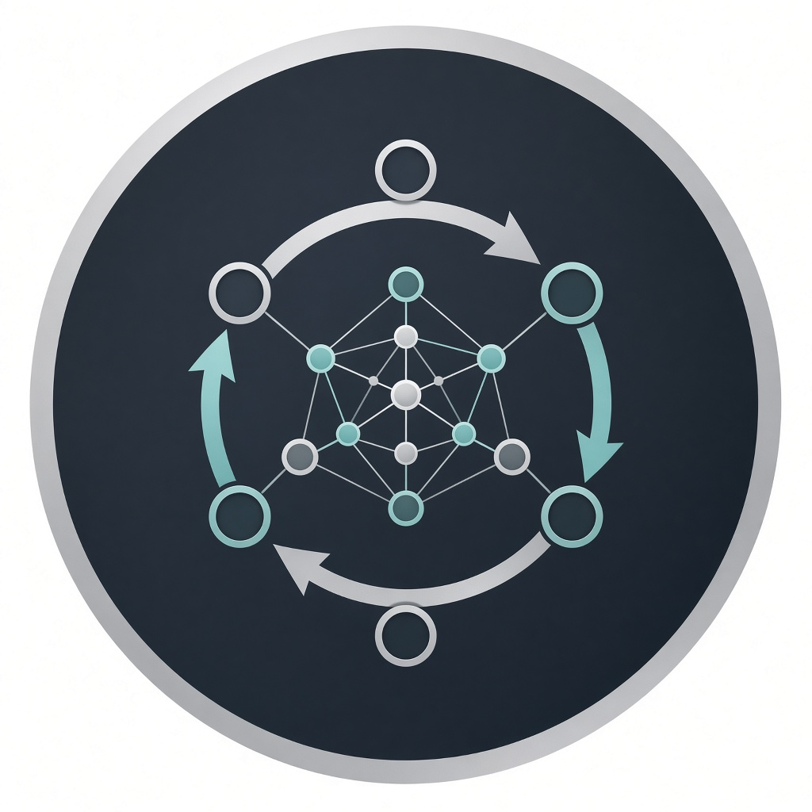
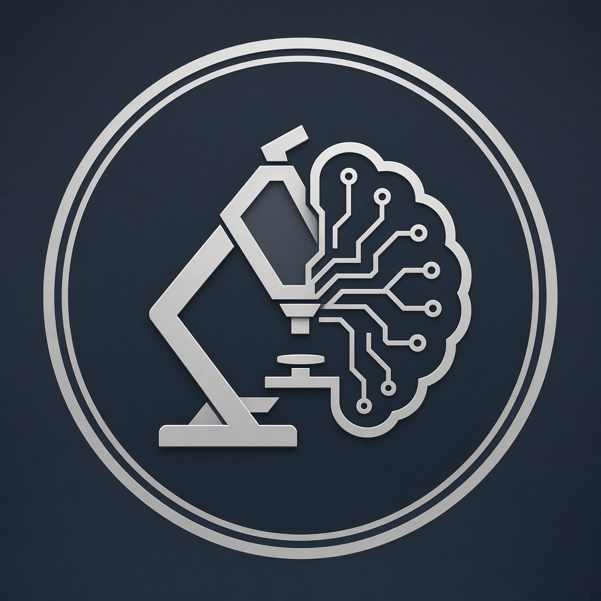

  

  

<h1 align="center">Ka Reigh Mitchell Gary</h1>
<h3 align="center">Senior AI Engineer and Applied ML Researcher</h3>

<i>Agentic systems · Multimodal GenAI · Production ML · Creative Intelligence</i>

  
  
  

  
  
  
  

  

  

## About Me

<table align="center">
<tr>
<td valign="top" width="50%">

Building <b>agentic GenAI systems</b> for real workflows

Deepening <b>multimodal models</b> and evaluation harnesses

Open to collaborate on <b>LLM agents</b> and applied research

Ask me about <b>RL · LLMs · DSP · production ML</b>

</td>
<td valign="top" width="50%">

Focus: <b>research prototype to production systems</b>

Shipping frameworks like <b>SuperClaude</b> and automation agents

Email: <a href="mailto:k.reighmitchell@gmail.com">k.reighmitchell@gmail.com</a>

Fun fact: I treat every repo like a product, not a dump

</td>
</tr>
</table>

  

## Stack

  

  
  
  
  
  
  

  
  &nbsp;&nbsp;
  
  &nbsp;&nbsp;
  

  
  

  

## GitHub Stats

  
  
  

## Language Mix

  
  

  

## Current Focus

- Production-ready <b>agent frameworks</b> and computer-use automation
- <b>Multimodal</b> learning systems spanning text, audio, and interaction
- Reliable ML delivery: evals, guardrails, observability
- Creative-technical systems (DSP, OSC/MIDI, interactive hardware)

---

  <b>Let's build intelligent systems that ship.</b> 
  <a href="mailto:k.reighmitchell@gmail.com">k.reighmitchell@gmail.com</a>
  ·
  <a href="https://github.com/kreighmitchell">github.com/kreighmitchell</a>
  ·
  <a href="https://www.linkedin.com/in/kreighmitchell">LinkedIn</a>

